# Quintal dos Moinhos

Site de apresentação de um hotel pequeno em Holambra (SP), com 24 quartos, jardim com piscina e café da manhã colonial. A reserva acontece pelo WhatsApp: o visitante escolhe datas, hóspedes e quarto, vê uma estimativa do valor e abre a conversa com a mensagem pronta.

É um projeto de portfólio com empresa fictícia. Nome, telefone, endereço, CNPJ, e-mail e avaliações são de exemplo.

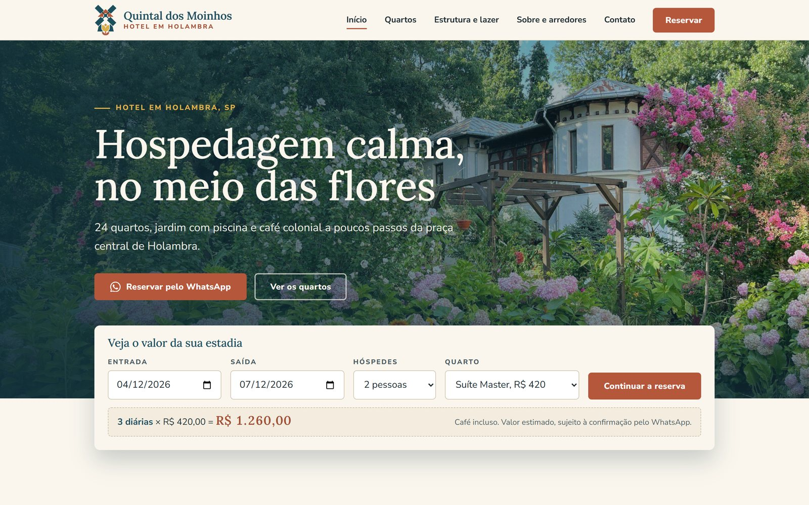

## Reserva pelo WhatsApp

A página inicial já mostra o valor da estadia: datas, número de hóspedes e quarto. O cálculo é de diárias vezes o preço do quarto, com café incluso, e o site avisa quando o quarto não comporta os hóspedes. O botão "Continuar a reserva" abre a página de contato com tudo preenchido.

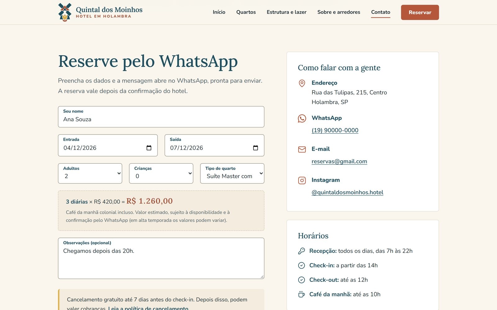

No formulário, os campos têm rótulo flutuante e os erros aparecem junto de cada campo. Ao enviar, o site monta a mensagem e abre o WhatsApp. A reserva só vale depois que o hotel confirma por lá, e o site não cobra nada.

## Quartos e galeria

Os quatro tipos de quarto aparecem com capacidade, comodidades e diária. No computador, o cartão se enche da cor do hotel quando o mouse passa por cima.

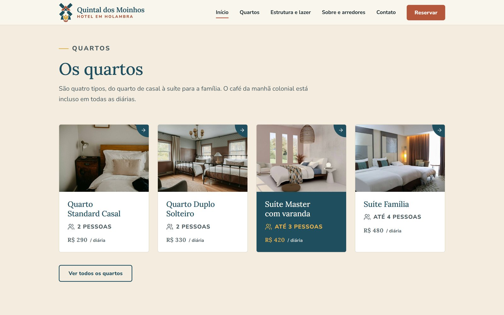

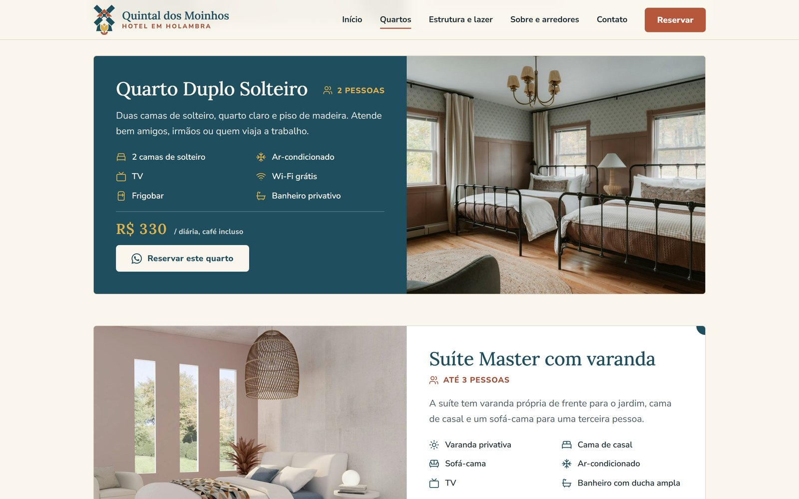

A galeria da página Estrutura filtra por categoria com um seletor deslizante. As fotos abrem ampliadas, e as setas do teclado e a tecla Esc funcionam. O filtro escolhido vai para o endereço da página, então dá para compartilhar o link já filtrado.

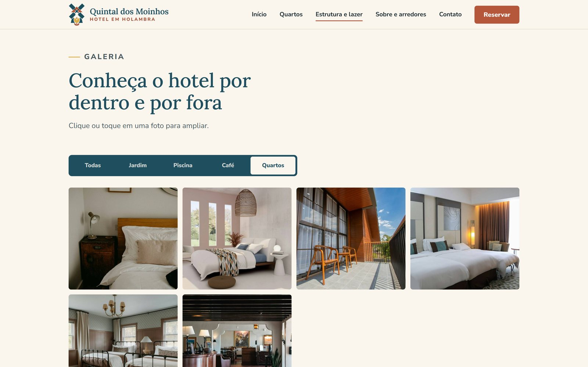

## No celular

Em telas pequenas, a primeira tela mostra o hero inteiro e o começo da barra de reserva. Os cartões viram linhas compactas, o menu ocupa a tela toda e o botão do WhatsApp fica fixo no canto. Uma tela de carregamento aparece só se a página demorar mais de 400 ms.

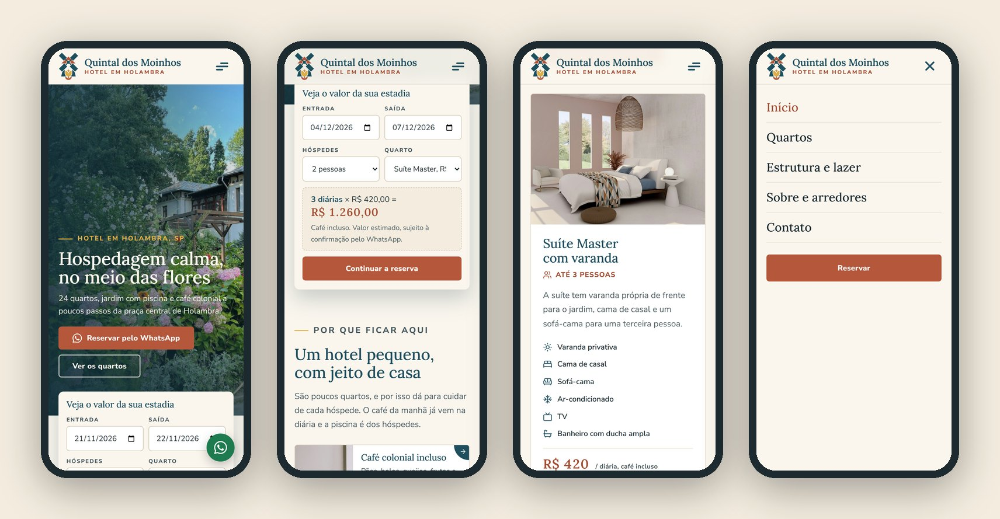

<details>
<summary>Ver as páginas inteiras (computador)</summary>

Início

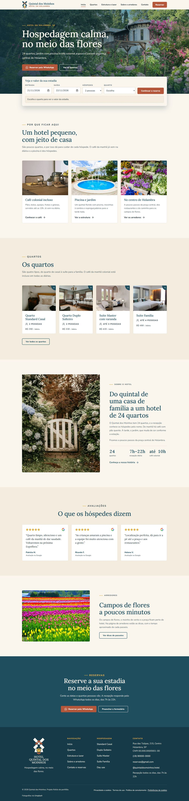

Quartos

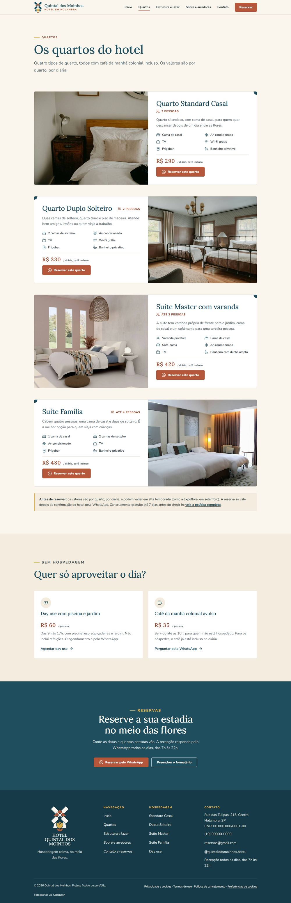

Estrutura e lazer

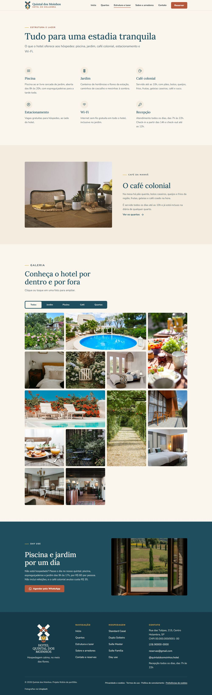

Sobre e arredores

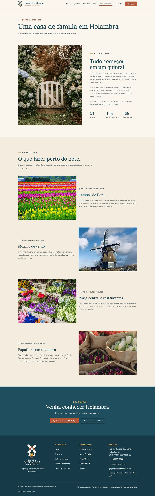

Contato e reservas

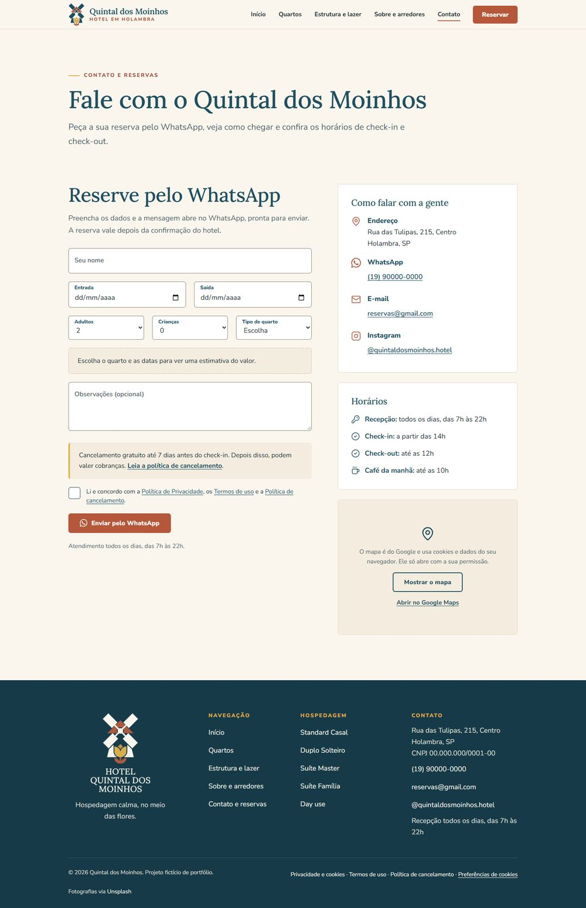

</details>

## Páginas

| Página | Conteúdo |
|---|---|
| Início | Hero com foto do jardim, barra de reserva com prévia de valor, destaques, quartos, sobre, avaliações, arredores e chamada para reservar |
| Quartos | Quatro tipos de quarto, com foto, capacidade, comodidades, diária e botão de reserva; day use e café avulso |
| Estrutura e lazer | Piscina, jardim, café colonial, estacionamento e Wi-Fi, mais a galeria e o day use |
| Sobre e arredores | História do hotel e dicas de passeios em Holambra |
| Contato e reservas | Formulário de reserva, endereço, horários de check-in e check-out e mapa |
| Termos de uso, Política de cancelamento e Privacidade | Textos de exemplo, com direito de arrependimento de 7 dias, cookies e LGPD |
| Obrigado, 404 e Créditos | Página depois do envio, página de erro e créditos e licenças de fotos, fontes, ícones e componentes |

## Detalhes do site

- O aviso de cookies tem o botão Recusar. Nada rastreia o visitante, e o mapa do Google só abre depois do aceite.
- O formulário guarda a data do aceite da política de privacidade e dos termos só no navegador de quem preenche.
- O layout é responsivo e respeita a preferência por menos movimento.
- As imagens têm três tamanhos (`srcset`), carregamento tardio e dimensões declaradas.
- Os cabeçalhos de segurança, com política de conteúdo, ficam no arquivo `_headers`.
- Há favicons completos, `site.webmanifest`, `sitemap.xml`, `robots.txt` e imagem de compartilhamento (Open Graph).

## Tecnologias

HTML, CSS e JavaScript puros, sem dependências no navegador e sem etapa de build.

- Fontes: [Lora](https://fonts.google.com/specimen/Lora) e [Nunito Sans](https://fonts.google.com/specimen/Nunito+Sans), licença SIL OFL, servidas pelo próprio site.
- Ícones: [Lucide](https://lucide.dev) (ISC) e o ícone do WhatsApp do [Simple Icons](https://simpleicons.org) (CC0).
- Fotografias: [Unsplash](https://unsplash.com), licença Unsplash. Os autores estão na página de créditos.
- Componentes de interface adaptados de elementos do [Uiverse](https://uiverse.io), licença MIT: botões, campo de texto, caixa de aceite, filtro da galeria, cartões e ícone do menu. Os autores também estão na página de créditos.

## Identidade visual

| Papel | Cor |
|---|---|
| Azul-petróleo | `#1F4E5F` |
| Terracota | `#B5573B` |
| Dourado | `#E0B24A` |
| Off-white | `#FAF6EE` |

## Como rodar

O site é estático. Na pasta do projeto, qualquer servidor local serve:

```bash
python -m http.server 8080
```

Abra http://127.0.0.1:8080/index.html. Esse servidor simples não aplica o arquivo `_headers` nem mostra a `404.html` para endereços inexistentes, o que só acontece na hospedagem.

Para abrir o site no celular, na mesma rede Wi-Fi, use o endereço do computador na rede (por exemplo `http://192.168.0.10:8080`).

## Estrutura

```
index.html  quartos.html  estrutura.html  sobre.html  contato.html
termos.html  cancelamento.html  privacidade.html  obrigado.html  creditos.html  404.html
sitemap.xml  robots.txt  share.jpg  favicon.ico  site.webmanifest  _headers
assets/
  css/style.css     estilos de todas as páginas
  js/main.js        menu, galeria, formulário, cookies, botão flutuante e tela de carregamento
  js/icons.js       ícones embutidos
  icons/            ícone do Google usado nas avaliações
  fonts/            fontes em woff2
  img/              fotos em 3 tamanhos (800, 1200 e 2000 px)
  logo/             logo em PNG com fundo transparente
docs/screenshots/   imagens deste README
```

## Mudar o conteúdo

Textos, quartos e preços ficam direto nos arquivos `.html`. Estilos em `assets/css/style.css` e comportamento em `assets/js/main.js`.

## Aviso

Projeto de demonstração. Os textos de privacidade, termos e cancelamento são exemplos e não substituem orientação jurídica.
